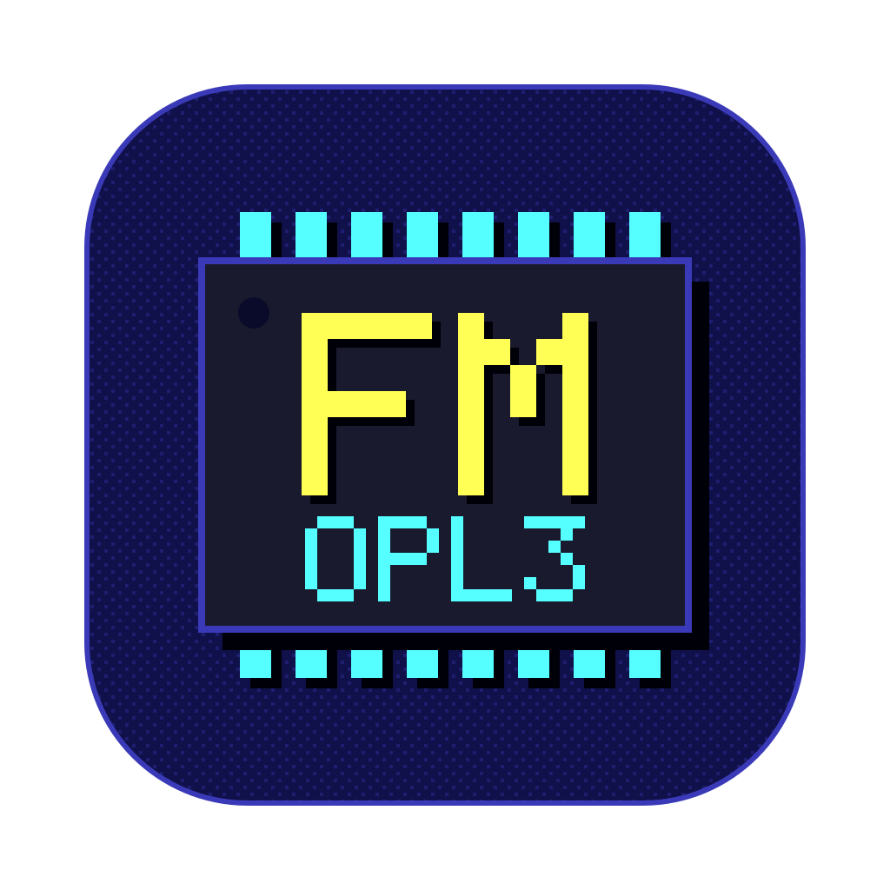

# FmControl

Editor and librarian for the **MIDIbox FM** (V1.4, e.g. the sammichFM). It runs as a standalone Mac app, or as an
AU or VST3 plugin. A sibling of [SidControl](https://github.com/baconjuice/SidControl).

It talks to the box with the MIDIbox FM SysEx protocol (`F0 00 00 7E 49 <device> ...`). The spec is
`apps/synthesizers/midibox_fm_v1/doc/midibox_fm_sysex_implementation.txt` in
[midibox/mios8](https://github.com/midibox/mios8).

## Build

Requires Xcode (or the command line tools) and CMake (`brew install cmake`).

```bash
git submodule update --init
cmake -B build -DCMAKE_BUILD_TYPE=Release
cmake --build build -j
ctest --test-dir build
```

Output is in `build/FmControl_artefacts/Release/`, in the `Standalone/`, `AU/` and `VST3/` folders.

## Using it

1. Pick the **MIDI In** and **MIDI Out** your MIDIbox FM is connected to, then press **Test**.
2. Choose the **Voice** (1-4) to edit. Each voice plays its own patch; the first time you pick a voice
   its patch is read from the box.
3. **Live** (on by default): every edit is sent to that voice as you make it. **Get Voice** reads its patch again,
   **Send Voice** sends the whole patch.
4. Pages:
   - **Operators**: algorithm (with a diagram), OP1 feedback, and per operator the OPL3 waveform, frequency
     multiplier, volume, envelope (with a graph), sustain/vibrato/tremolo/KSR flags and key scaling.
   - **Modulation**: LFO1, LFO2 and EG5 with their routings to pitch, operator volumes, the other LFO and AOUT.
   - **Play & Controllers**: play mode, portamento, finetune, bend range, MIDI clock sync, and what velocity,
     aftertouch and the modwheel control.
   - **Wavetable**: the 32-step wavetable sequencer.
5. Librarian (left): banks A-H with 128 patches each, fetch/store/bank transfers, `.syx` files (the official
   preset banks open directly), right-click for copy, paste, init and clear.
6. **Keys**: MIDI from your keyboard or the DAW track goes to the box, by default on the edited voice's channel
   (each voice's MIDI channel comes from the ensemble; channels 1-4 by default).

Drum sets: press **DR** next to the voice buttons. The editor then shows the drum set (the OPL3 rhythm
section: bass drum modulator and carrier, open and closed hi-hat, snare, tom, cymbal) with each instrument's
waveform, multiplier, volume and envelope, the pitch and pitch drop of bass drum, hi-hat and tom, the three
feedback settings, FM/AM for the bass drum, the audio outputs and the key range of each drum. The librarian
switches to the bank's 16 drum sets, and **Get / Send**, **Init**, **Open / Save .syx** and **Random...** work on
the drum set. **Play** plays a bar of drums with the kit. The box plays drums on MIDI channel 16 (firmware
default); a Program Change on channel 16 picks a stored set (bank x 16 + set). Drum sets have no names on the
box. **Init Kit** is the first preset drum set; the firmware's 16 preset sets
(`presets/bank1/midibox_fm_drumsets.syx` in the firmware package) open with **Open .syx**. The drum random
generator is FmControl's own (the box has none): it keeps attacks fast, releases moderate, the instruments
audible and the bass drum's multipliers low, and never changes key ranges or outputs.

Ensembles: press **EN**. The editor shows, for each of the four voices, the stored patch it plays (bank and
number, with its name when the library knows it), its MIDI channel, key range, velocity mode, volume,
transpose, unisono and the audio outputs of operators 1+2 and 3+4. The librarian switches to the bank's 32
ensembles. Changing a voice's Bank or Patch loads that patch into the voice at once; the other settings are
sent as you turn them, and the voices, the keyboard and **Play** (which plays every voice) use the
ensemble's channels. On the box, loading an ensemble (**Send**, **Store** or **Fetch**) makes all four voices
reload their stored patches and the drum set its stored set, so unsaved edits of those are lost; FmControl
reads them back afterwards. Reading a stored ensemble also switches the box to it, so **Fetch Bank** asks first
and puts the ensemble that was playing back at the end. Ensembles have no names. **Init Ens.** is the
firmware's preset ensemble (`presets/bank1/midibox_fm_ensembles.syx`).

Random generator: **Random...** in the patch header works like the RND menu on the box, for the voice being
edited. Click a section (All, OP, LFO, EG5, WT Config, WT Steps) to roll it. It follows the firmware's rules
(`mbfm_rnd.inc`): OP1/OP3 get low multipliers and high volume, OP2/OP4 stay at full volume, sustain stays
audible, and LFO/EG5 never modulate the OP2/OP4 volume. With **Amount** below 100% it only nudges the current
sound. **Undo** steps back through the rolls (per voice).

DAW automation (plugin): 24 automatable parameters, "slots". Slots 1-16 are for the voices; the defaults cover voice 1: the four operator
volumes, feedback, OP1/OP3 multiplier and decay, LFO1 rate and pitch depth, LFO2 rate, EG5 attack and decay,
wavetable rate and finetune. Right-click any control and choose **DAW Automation Slot** to put it on a slot;
the slot drives that parameter of the voice you were editing (shown as "V2 OP1 Volume" and so on), so
automation keeps working when you switch voices in the editor.
Slots 17-24 are for the drum set (shown as "DR BD Pitch" and so on); the defaults are bass drum pitch and
pitch drop, bass drum, snare, closed hi-hat and cymbal decay, and hi-hat and tom pitch. Drum controls can
only go on drum slots and voice controls on voice slots.

MIDI learn: right-click any knob, button or menu and choose **MIDI Learn**, then move a controller. A mapped
controller always edits the voice you are editing; controllers learned on the drum set page always edit the
drum set, whichever part is shown. Each controller belongs to one parameter, so learning it again moves it.
Mapped CCs change the editor and are not passed through to the FM; unmapped CCs pass through as before.

The look is a nod to early-'90s DOS music trackers on OPL3 sound cards: VGA colours, text-mode windows and
a 5x7 pixel font (`Source/ui/PixelFont.cpp`, drawn for this app). The icon (a pixel-art OPL3 chip) is generated by
`Tools/make_icon.py`.

`fmcli` (built with the app) is a diagnostics tool: `list`, `scan`, `ping`, `get`, `getslot`, `monitor`, `play`, and `resend` / `parburst` / `rawwrite` / `fetchbank` to test whether patch writes get through.

Patch dumps are sent in small pieces (4 bytes every 10 ms, about 0.9 s per patch): the FM drops bytes of a dump that arrives at full MIDI speed and then never answers.

## Credits

FmControl would not exist without **Thorsten Klose (TK.)** and the [MIDIbox](http://www.midibox.org) community.
The MIDIbox FM, its firmware, the SysEx protocol and the preset patches are TK.'s work. FmControl is only a remote
control for them.

- The parameter tables follow `midibox_fm_cc_voice.txt` and the firmware sources in
  [midibox/mios8](https://github.com/midibox/mios8).
- `Source/fm/CcNames.cpp` (parameter names) is generated from `midibox_fm_cc_voice.txt`.
- `Source/fm/InitPatch.cpp` and `Tests/fixtures/midibox_fm_voices.syx` come from the firmware's preset bank,
  the init kit in `Source/fm/Drums.cpp` and `Tests/fixtures/midibox_fm_drumsets.syx` from its preset drum sets,
  the init ensemble in `Source/fm/Ensemble.cpp` and `Tests/fixtures/midibox_fm_ensembles.syx` from its preset
  ensembles.

Those files are Copyright 1998–2007 Thorsten Klose (tk@midibox.org) and are "licensed for personal
non-commercial use only". FmControl is a free, non-commercial hobby project. Please don't use any of it commercially.

FmControl is built with [JUCE](https://juce.com). The sammichFM hardware comes from the MIDIbox community.
